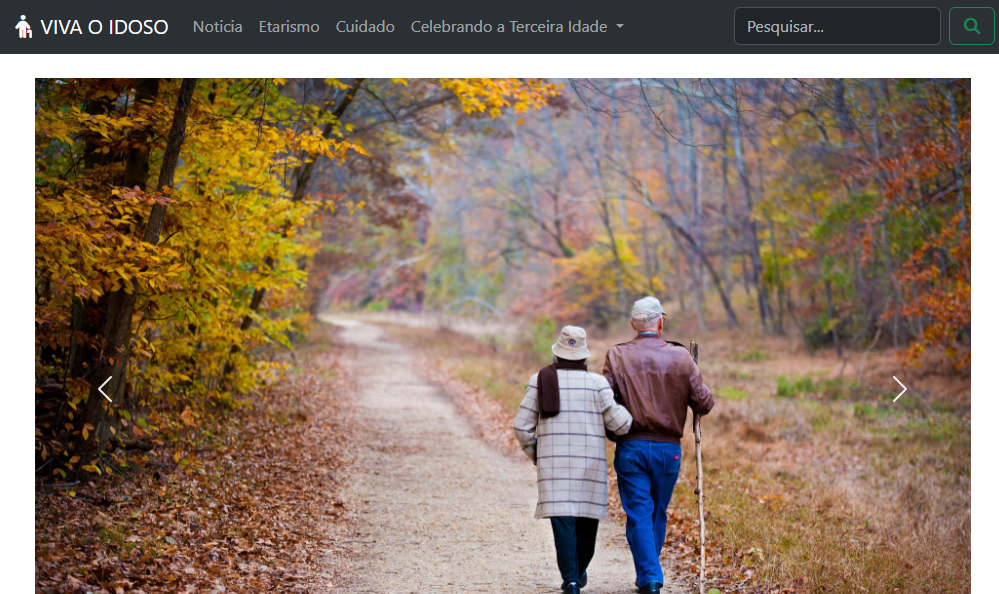

# Viva o Idoso — Site de Conscientização

**Projeto acadêmico | HTML5 • CSS3 • Bootstrap • JavaScript**

## Sobre o projeto

O **Viva o Idoso** é um site acadêmico desenvolvido para promover a conscientização sobre a valorização, os direitos, os cuidados e o respeito às pessoas idosas.

## Objetivo

Contribuir para a divulgação de informações sobre o envelhecimento e incentivar uma sociedade mais consciente e respeitosa com a população idosa.

## Tecnologias utilizadas

- **HTML5:** estrutura das páginas.
- **CSS3:** estilização visual.
- **Bootstrap:** componentes e recursos de layout.
- **JavaScript:** recursos de interação.
- **Font Awesome:** biblioteca de ícones.

## Estrutura do projeto

- `index.html` — página principal.
- `css/` — arquivos de estilos.
- `js/` — arquivos JavaScript.
- `img/` — imagens do projeto.
- `fontawesome/` — arquivos de ícones.

## Como executar

1. Baixe ou clone este repositório.
2. Mantenha os arquivos e pastas na estrutura original.
3. Abra o arquivo `index.html` em um navegador.

## Acesso ao código

[Consultar o repositório no GitHub](https://github.com/erikmartins007/viva-o-idoso)

## Contexto acadêmico

Projeto desenvolvido no contexto de atividades acadêmicas do curso de Sistemas de Informação.

## Demonstração visual

A imagem abaixo apresenta a página inicial do site Viva o Idoso.

